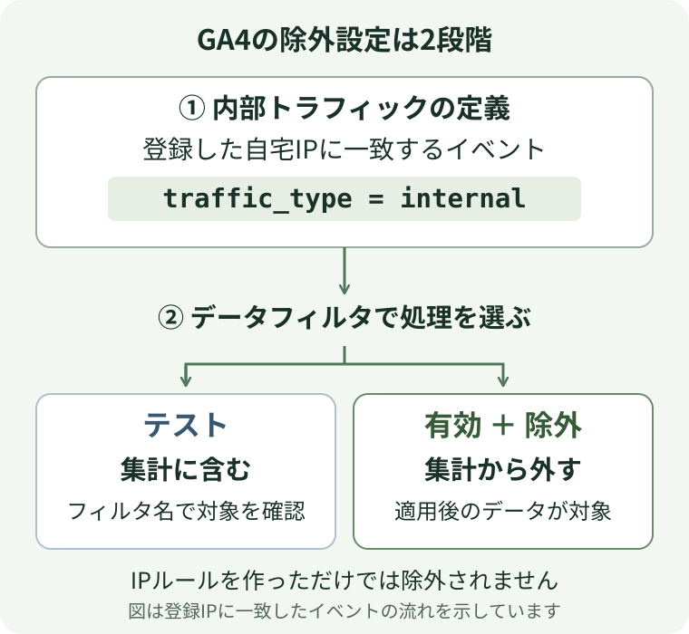

ブログを更新したら、PCで記事を開いて、iPhoneでも開きます。誤字を直したらまた両方で開く。これを繰り返していると、アクセス解析の数字のうち何回が自分なのか気になってきました。

そこでGA4で自宅からのアクセスを除外しました。それでも自分の閲覧が混ざっている気がして、最初は自宅のIPアドレスが変わったのではと疑いました。確かめてみると、違いがはっきり出たのは、同じiPhoneのWi-Fiを切ったときでした。

## 「自宅」に引っ越し前のIPが残っていた

10月3日にGA4の「内部トラフィックの定義」を開くと、「自宅」という名前のルールがすでにありました。ただ、値は引っ越し前のIPアドレスのまま。データフィルタも「テスト」のままでした。テストの間は、条件に合うアクセスにフィルタ名が付くだけで、集計には含まれます。[Google公式ヘルプ「内部トラフィックの除外」](https://support.google.com/analytics/answer/10104470?hl=ja)

翌4日に、今の自宅のIPで登録し直しました。GA4の「探索」でフィルタ名の付いたイベントを確認して、フィルタを「有効」に変更。一緒に確認した同僚(チャットGPT様)の返事はこうでした。

> 除外設定の有効化まで完了です。

同じ返事には、反映を待ってから動作を確認するようにとも書いてありました。ただ、こちらは「完了です」の言葉がまず目に入ります。自宅からのアクセスを設定しただけなのに、いつの間にか自分のアクセス対策が済んだ気になっていました。

## 同じiPhoneでWi-Fiを切ってみた

11月13日に、自宅PCのブラウザでIP確認サイトを開き、表示されたグローバルIPv4とGA4の「自宅」ルールを見比べました。末尾まで一致していて、マッチタイプは「IP アドレスが次と等しい」です。

そのうえでPCとiPhone 17 Proからブログを開き、GA4のリアルタイムレポートに自分の閲覧が出るかを見ました。

| 端末 | 接続した回線 | リアルタイムでの結果 |
| --- | --- | --- |
| PC | 自宅Wi-Fi | 閲覧は表示されなかった |
| iPhone 17 Pro | 自宅Wi-Fi | 閲覧は表示されなかった |
| 同じiPhone 17 Pro | モバイル回線 | 閲覧が表示された |

自宅Wi-Fiでは、PCもiPhoneも除外されました。念のため、iPhoneのWi-Fiを切ってブログを開くと、自分の閲覧が出てきました。

## 【補足】なぜモバイル回線だと計測されたのか

今回の設定では、GA4は登録したIPと一致するアクセスに `traffic_type = internal` という目印を付け、有効にしたデータフィルタがその目印付きのイベントを集計から外します。モバイル回線で開いたときの送信元IPが登録した自宅のIPと違えば、その閲覧は普通に計測されます。

※回線によっては、自宅のグローバルIPアドレスが変わることがあります。以前は除外できていたのに自分の閲覧が表示されたら、現在のIPとGA4の登録値を見比べてみてください。

## 最後に

本当に消したかったのは、家でPCから表示を直した1回も、電車でiPhoneから記事を読み返した1回も、全部ひっくるめた「自分の閲覧」でした。今回の設定で除外できたのは、そのうち自宅Wi-Fiで開いた分です。(VPN契約を検討するほど固執してない)

同じように「まだ自分の分が混ざっていそう」と感じたら、登録するIPを増やす前に、スマホのWi-Fiを切って同じページを開いてみてください。有効にしたフィルタで本物の読者まで除外してしまうと、その閲覧は後から戻せません。[Google公式ヘルプ「データフィルタ」](https://support.google.com/analytics/answer/13296761?hl=ja)
