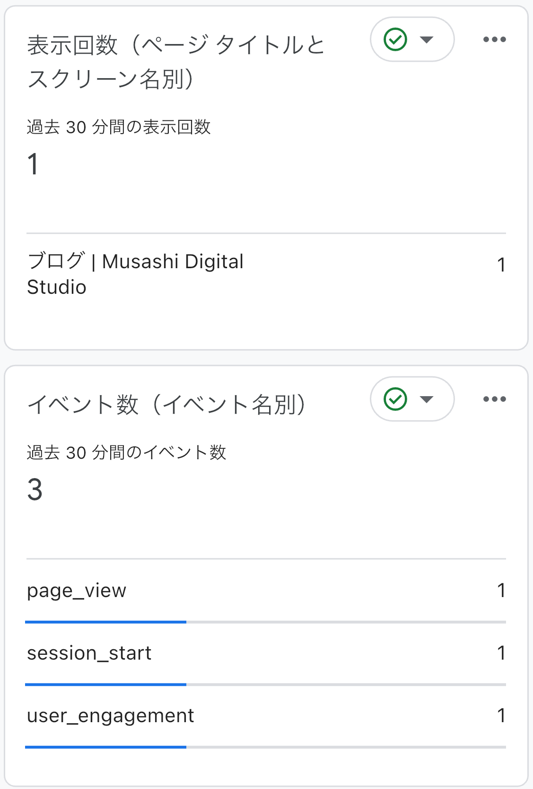

前回、[GA4で自宅Wi-Fiからのアクセスを集計から除いた](/blog/2026/11/14/ga4-exclude-own-traffic/)。では、ChatGPTに「ブログを開いて」と頼んだら、読者が1ページ見たときと同じように数えられるのだろうか。リアルタイムの閲覧者が少ないと推測される11月15日の深夜、同じ記事一覧をChromeとPythonで1回ずつ開き、Google アナリティクス 4（GA4）のリアルタイムレポートを確認した。

## 調査内容

同じページをChromeとPythonで1回ずつ開く方法で確認した。

調査したのは `musashistudio.com/blog/`。ページは同じまま、URLの末尾の `check` というパラメータに、開き方ごとに違う目印を付けた。記録をたどれるよう、以下は目印の文字列だけを載せている。

| 日本時間（開始） | 操作と目印 | 確認事項 |
|---|---|---|
| 11月15日 00:27:25 | ChatGPTがChromeで表示。`ga4-261115-browser-f7c2` | 「記事一覧」が表示され、表示後のURLにも目印が残った。 |
| 11月15日 00:27:55 | Pythonの標準ライブラリ `urllib.request.urlopen` でGET。`ga4-261115-python-f7c2` | HTTP 200。HTMLは76,929バイト。タイトルとGA4の測定IDを含む。JavaScriptは実行していない。 |

## リアルタイムのアクセス確認結果

2回のアクセスの約3分後、0時30分に確認した画面には、過去30分のブログ一覧の表示が1回、`page_view` も1件と出ていた。

| 項目 | スクリーンショットの表示 |
|---|---|
| 過去30分のユーザー数 | 1 |
| 端末区分 | desktop 100% |
| 国 | Japan 1 |
| ページタイトル別の表示回数 | ブログ &#124; Musashi Digital Studio が1回 |
| イベント数 | 合計3件。page_view、session_start、user_engagement が各1件 |
| キーイベント | 0 |
| ユーザーの最初の参照元・メディア・キャンペーン | いずれも未設定 |

時刻、記事一覧のタイトル、`desktop` という端末区分がそろっている。今回の1PVには、直前にChatGPTがChromeで開いた操作が関係している可能性が高いと考えている。ただし、画面に表示されたのは過去30分の集計値。URLの目印までは照合しておらず、同じ時間帯に別の人が記事一覧を開いた可能性も残る。

イベント数の「3」は3PVという意味ではない。3種類のうち、ページの表示を数える `page_view` は1件だった。[Googleのリアルタイムレポートの説明](https://support.google.com/analytics/answer/9271392?hl=ja)

## PythonでHTMLを取得するとどうなるか

今回、Pythonで分かったのは、ページの取得に成功し、返ってきたHTMLにGA4の測定IDが含まれていたことだ。使った `urlopen` はHTML内のJavaScriptを実行しない。この取得だけでページ内のGoogleタグが動くとは考えにくいが、Python側の目印に対応する `page_view` が0件だったかは確認できていない。

PythonからChromeを起動してページを表示すれば、今回の単純なGETとは条件が変わる。AIの種類に加えて、ブラウザで表示したのか、HTMLを取り出しただけなのかも、結果を読むうえで大切になる。

ここで見ているのは、ブログに設置したGoogleタグがGA4に送るページビューだ。Webサーバーがリクエストを受けた回数や、検索用クローラーの訪問回数とは数え方が違う。[Googleのページビュー計測の説明](https://developers.google.com/analytics/devguides/collection/ga4/views?hl=ja)

## 調査結果

簡単ではあるが調査した結果、**ChatGPTによる閲覧が、GA4の閲覧記録に反映されることが強く疑われる**。

数十回の閲覧記録として反映されるわけではないが、閲覧数を確認する際は考慮すべきだと考える。

## 補足

個人的には今回の調査で満足する結果が得られた。

一方で閲覧数などの反響がよければ、調査専用ページを用意するか、そのページだけで動く計測タグを追加して、通常の読者の閲覧と区別しやすくしたい。

そのうえで、ClaudeやGeminiにも同じページを開いてもらう。どのAIを使ったかと、実際にどの方法でページを取得したかを記録し、GA4での見え方を比べてみたい。
