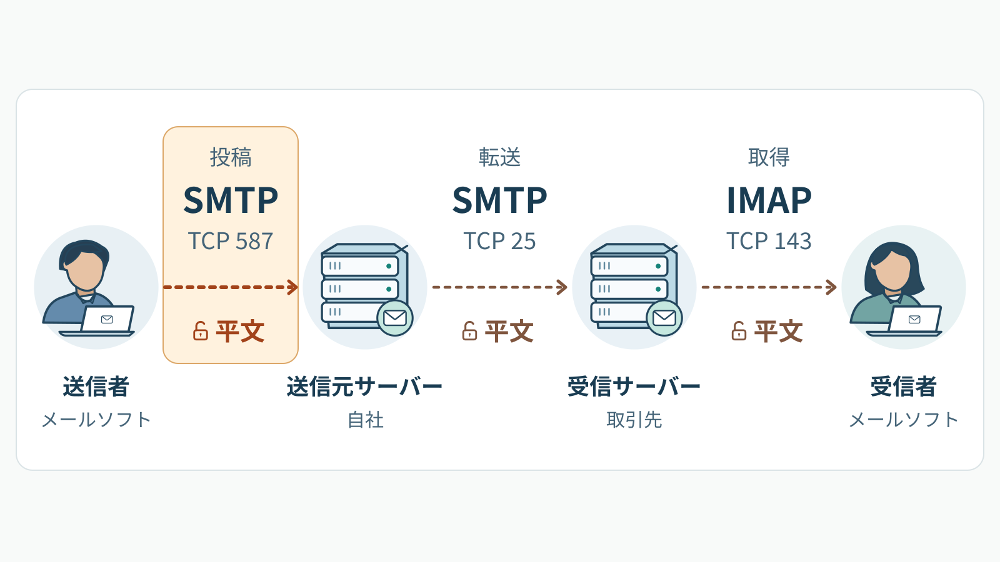
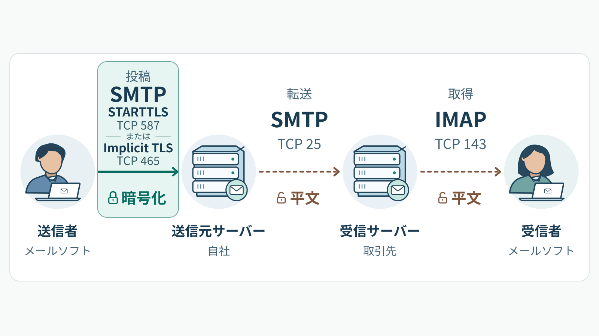
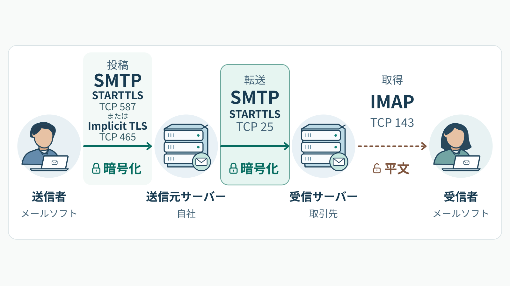
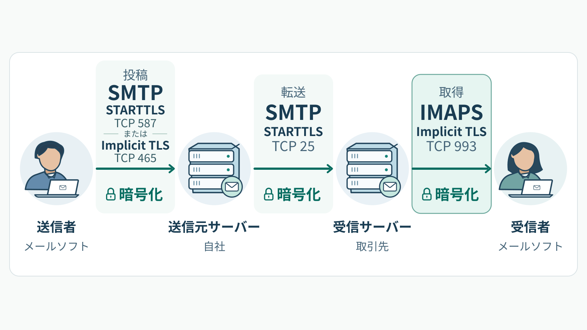
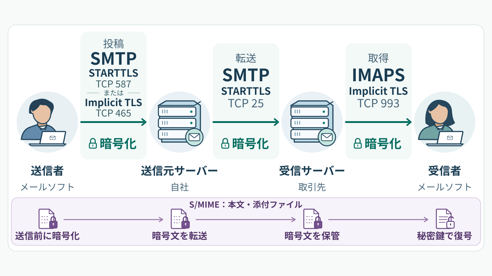

取引先に見積書を送るため、メールソフトの送信設定を開きました。社内の設定資料には「587番・STARTTLS」とあります。このとおりに設定したら、見積書は取引先の担当者が開くまで、ずっと暗号化されたままでしょうか。

**この設定で守れるのは、自分のメールソフトから自社の送信元サーバーまでです。** 送信ボタンを押してから相手が受信トレイを開くまでには、「投稿」「転送」「取得」という三つの通信があります。さらに、通信が終わったあとも見積書を暗号化しておきたいなら、メールの中身にも鍵が必要です。1通の見積書を、五つの図で追ってみましょう。

## ① SMTPの問題点｜平文で送ると何が見える？

送信ボタンを押すと、メールソフトは自社の送信元サーバーにメールを預けます。これが**投稿**です。次に、自社のサーバーが取引先の受信サーバーへメールを渡します。これが**転送**です。どちらにもSMTP（Simple Mail Transfer Protocol）を使います。取引先のサーバーが「SMTPで受信する」とは、この転送を受け付けるという意味です。

では、取引先の担当者が受信トレイを開くときはどうでしょう。メールはすでに取引先のサーバーに届いています。担当者のメールソフトはそこへ接続し、IMAPやPOP3でメールを**取得**します。図の右端の矢印はメールが届く向きで、接続を始めるのは受信者側です。

SMTPのやり取りでは、送る側が `MAIL FROM` で配送上の差出人を、`RCPT TO` で配送先を伝え、`DATA` に続けて件名・本文・添付ファイルを渡します。図①は、どの区間でもTLSを使わない例です。このとき、回線上の通信を観測できる第三者は、宛先や本文を読み取り、添付の見積書も復元できます。添付ファイルがBase64で英数字の羅列に見えても、元に戻すのに秘密の鍵は要りません。

## ② 送信時の通信を守る｜587番でSTARTTLSを選ぶ理由

まず、図の左端にある「投稿」を保護します。メールソフトの送信設定に出てくる**STARTTLS**と**Implicit TLS**は、どちらもこの区間でTLSを使う方法です。違いは、サーバーとの最初の会話にあります。

|送信サービスの指定        |接続してから見積書を送るまで                                                                              |
|-----------------|--------------------------------------------------------------------------------------------|
|587番・STARTTLS    |まずSMTPの挨拶を平文で交わす。サーバーが対応を知らせたら、メールソフトが `STARTTLS` を要求する。同じ接続でTLSを確立し、改めて挨拶してからログイン情報とメールを送る。|
|465番・Implicit TLS|接続直後にTLSを確立する。最初のSMTPの挨拶から、ログイン情報やメールの送信まで、すべてTLSの内側で行う。                                    |

社内資料が「587番・STARTTLS」を指定するのは、その窓口が**最初にSMTPの挨拶を待っているから**です。メールソフトだけをImplicit TLSに変えると、話し始める順序がかみ合いません。また、図①と図②で投稿のポート番号が同じなのにも注目です。587番を選んだだけでは暗号化されず、TLSが確立して初めて、この回線を流れる見積書が暗号化されます。

この記事を読んでいるあなたが情シスなら、確認したいのは、接続先に合う証明書を検証しているか、そして**TLSを確立できないときに、パスワードもメールも送らずに止まるか**です。標準のRFC 8314はメールソフトの投稿・取得にImplicit TLSを推奨しています。一方、投稿前のTLS確立を双方で必須にして正しく実装・設定すれば、587番のSTARTTLSと465番のImplicit TLSの安全性に実質的な差はないとしています。

## ③ サーバー間の転送も守る｜25番で始まる別の通信

見積書を預かった自社のサーバーは、今度は自分が送る側になり、取引先の受信サーバーに接続します。インターネット上のメールサーバー同士が転送に使うのは通常TCPの25番です。ここで両者がSTARTTLSを使えば、見積書はこの回線上でも暗号化されます。

図②で作ったTLS接続は、自社のサーバーで終わっています。したがって、社員がメールソフトで「STARTTLS必須」を選んでも、取引先までの転送には引き継がれません。**図③で新しく守られたのは、中央のサーバー2台が別途TLSを確立した区間です。**

この違いは、相手がTLSに対応していないときに表れます。配送を優先し、使えるときだけTLSを使う運用では、平文で転送することがあります。その宛先への配送にTLSを必須としていれば、条件を満たすまで平文では送りません。途中に別の中継サーバーが入れば、その前後でもそれぞれの接続について考えます。

## ④ 受信時の通信を守る｜最後の区間はIMAPS

見積書が取引先の受信サーバーに届きました。残っているのは、担当者がパソコンやスマートフォンで受信トレイを開く場面です。図③の例では、最後のIMAP通信はまだ平文なので、ここを観測されれば、せっかく暗号化して運んだ見積書の内容を読み取られてしまいます。

図④では**IMAPS（993番）**を使います。メールソフトが接続直後にTLSを確立し、その中でログインして、サーバー上のフォルダーや既読状態、メールの内容を同期します。メールを端末にダウンロードするPOP3を使う環境なら、Implicit TLSで取得する方式は**POP3S（995番）**です。ブラウザーでWebメールを開く場合は、ブラウザーとサービスの間に通常HTTPSを使います。

これで図の三つの矢印がすべて暗号化されました。それでも、**自社や取引先のメールサーバーは見積書の中身を扱えます。** 各サーバーは、自分宛てのTLS通信を復号してメールを受け取るからです。サーバーに保管するメールをどのように暗号化するかも、通信経路のTLSとは別に決まります。

## ⑤ S/MIMEで本文と添付ファイルを守る｜TLSと併用する理由

「配送の途中にあるサーバーにも、見積書の内容を読ませたくない」。ここで使えるのが**S/MIME（エスマイム）による暗号化**です。図⑤の上段は図④と同じ三つのTLS接続です。下段の紫色の見積書を追うと、今度はメールの中身に何が起きているかが分かります。

1. **送信前に暗号化する。** 送信者は、事前に取引先の担当者の証明書を入手して確認します。メールソフトは本文と添付の見積書を共通鍵で暗号化し、その共通鍵を受信者の公開鍵で保護します。
2. **暗号文のまま転送・保管する。** 図の例では、配送に携わるサーバーは受信者の秘密鍵を持ちません。各区間のTLSを復号しても、取り出せるのは暗号化された本文と見積書です。
3. **受信者の端末で復号する。** 取引先の担当者のメールソフトが、対応する秘密鍵を使って共通鍵を取り出し、本文と見積書を開きます。この例では、送受信者がS/MIME対応ソフトを使い、受信者自身の端末で復号します。

では、**S/MIMEを使えば、送信設定のTLSは外してよいのでしょうか。** 見積書をS/MIMEで暗号化しても、メールソフトが自社のサーバーにログインするときの認証情報や、SMTPが配送先を伝える `RCPT TO` コマンドは、その暗号化の対象外です。TLSを併用すると、そうしたやり取りも各回線上で保護できます。これが図⑤で上段のTLSを残した理由です。

## まとめ

冒頭の見積書に戻りましょう。「587番・STARTTLS」で守れるのは、自分のメールソフトから自社の送信元サーバーまでです。その先の転送と取得では、それぞれの区間でTLSを確立します。三つの区間すべてをTLSで守っても、途中のメールサーバーは見積書の中身を見ることができます。

取引先の担当者が開くまで見積書の中身を守りたいなら、送信前にS/MIMEで本文と添付ファイルを暗号化し、取引先の端末で復号します。その場合も、ログイン情報や配送先を回線上で守るためにTLSを併用します。**設定画面で確かめるのは「この接続はどこで終わるか」。見積書について確かめるのは「誰が復号の鍵を持つか」です。**

## 補足（試験向け）

令和5年度秋期の応用情報技術者試験・午後問1では、S/MIMEでメールを暗号化するときと、電子署名を付けるときに、それぞれどの鍵を使うかが問われました。鍵の持ち主に迷ったら、**暗号化なら「誰が開くのか」、電子署名なら「誰が署名したのか」**を設問に書き添えてみてください。

|目的              |送信者がすること                           |受信者がすること                          |
|----------------|-----------------------------------|----------------------------------|
|見積書を読める人を限る     |本文・添付を共通鍵で暗号化し、その鍵を**受信者の公開鍵**で保護する|**受信者の秘密鍵**を使って共通鍵を取り出し、本文・添付を復号する|
|送信者を確かめ、改ざんを検知する|**送信者の秘密鍵**で電子署名を付ける               |証明書を確認し、**送信者の公開鍵**で署名を検証する       |

見積書に電子署名だけを付けた場合、受信者は署名者を確認し、改ざんを検知できます。見積書の内容はそのまま読めるので、設問が「第三者に内容を読まれないようにする方法」を尋ねていたら、答えは暗号化です。

## 参考資料

- [RFC 5321 §3\.3 — SMTPによるメール配送の手順](https://datatracker.ietf.org/doc/html/rfc5321#section-3.3)
- [RFC 6409 §3\.1 — メール投稿用の587番ポート](https://datatracker.ietf.org/doc/html/rfc6409#section-3.1)
- [RFC 3207 §4 — SMTPのSTARTTLS](https://datatracker.ietf.org/doc/html/rfc3207#section-4)
- [RFC 8314 §3 — メールの投稿・取得におけるImplicit TLSとSTARTTLS](https://datatracker.ietf.org/doc/html/rfc8314#section-3)
- [RFC 8461 §5 — サーバー間の転送でTLSを必須にする例（MTA\-STS）](https://datatracker.ietf.org/doc/html/rfc8461#section-5)
- [RFC 8551 — S/MIMEの暗号化と電子署名](https://datatracker.ietf.org/doc/html/rfc8551)
- [IPA 令和5年度秋期 応用情報技術者試験 午後・採点講評（問1）](https://www.ipa.go.jp/shiken/mondai-kaiotu/ps6vr70000010d6y-att/2023r05a_ap_pm_cmnt.pdf)
