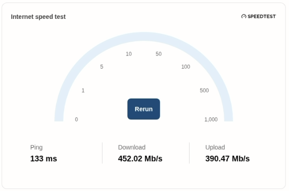

ブログを公開する前には、見出しの折り返し、画像の大きさ、表の読みやすさを自分の目で確認したくなります。私のブログはGitHub PagesとJekyllで運営しており、これまではPCとセルフホスト環境を使って公開前の表示を確認していました。

そこで、ChatGPTのクラウドブラウザを使い、iPhoneとPCから自分で画面を操作してみました。**手元でJekyllの環境を準備せずに、確認用のブログを開いて触れた**ことが、今回いちばん便利だと感じた点です。一方で、スクロールやボタンの反応には待ち時間がありました。

この記事は、2026年11月24日と25日の夜に試した記録です。使った構成と、実際の操作感を分けて残します。

## GitHubのビルド結果をクラウドブラウザで開く

このブログでは、GitHub ActionsがPRの内容を検査し、Jekyllでサイトをビルドしています。生成されたHTML・CSS・画像などの一式は、Actionsの成果物である「Artifact」として保存されます。

今回はChatGPTに、そのビルド済みファイルを取得・展開してもらいました。確認用のHTTPサーバーで配信し、クラウドブラウザで開いた画面の操作を私が引き継ぎます。**Jekyllを実行した場所はGitHub Actionsです。** ChatGPT側では、その結果を使って確認画面を用意しました。

[OpenAIの公式ヘルプ](https://help.openai.com/en/articles/20001280-using-cloud-browser-in-chatgpt)でも、クラウドブラウザは利用者の端末とは別のコンピューターで動き、スマホやPCから手動で操作を引き継げると説明されています。利用できる機能はプランや提供状況によって異なります。

大まかな手順は次のとおりです。

1. 確認したいPRやdevブランチの内容を指定する。
2. 対象と一致するビルド結果をChatGPTに取得してもらう。
3. クラウドブラウザで確認用サイトを開いてもらう。
4. ブラウザの操作を引き継ぎ、自分でスクロールやリンクの操作を試す。

依頼するときは、「公開前のブランチのビルド結果をクラウドブラウザで開き、私が手動で画面確認できるようにして」と伝えると、目的が明確です。今回の環境では、GitHubとの連携とクラウドブラウザを利用しました。

確認対象の取り違えにも注意しました。11月24日は、メールの暗号化を解説する記事の**公開前のPR #119**を表示しました。11月25日は最新のdevを対象にしましたが、この時点ではすでにPR #119が公開され、devとmainは同じ内容でした。2日目は、その内容をクラウド経由でPCから操作する確認です。

## iPhoneとPCのどちらでも、操作に待ち時間があった

試したのは、iPhoneとPCからクラウドブラウザを手動操作する方法です。どちらも23時台で、昼間の確認はしていません。

| 確認したこと | iPhone：11月24日 | PC：11月25日 |
| --- | --- | --- |
| ブログの画面を開く | 開いて確認できた | 開いて確認できた |
| 文字と画面の見やすさ | 静止中は読みやすい。小さい画面では指で拡大して操作した | ブログを開いて操作できたが、表示の広さについて細かな比較はしていない |
| 画面を動かしたとき | スクロール中に画質が荒くなった | スクロールやボタンの反応の遅さが気になった |
| スクロールやボタン操作 | 反応が遅いと感じた | 同じように遅いと感じた |
| 実用上の印象 | 待ちながら操作する場面があった | 押せたか不安になるほど待つ場面もあったが、使えないほどではなかった |

PCに切り替えても、反応の遅さは残りました。特に遅いときは、**ボタンを押せたのか不安になるほど、画面の変化を待つ場面**がありました。ただ、使えないほどではありませんでした。

それでも、自分でページを動かせる価値はあります。スクリーンショットだけでは確認しづらい目次の開閉や、リンクを押したあとの表示も、その場で試せます。細部を何度も調整する作業では待ち時間が気になりそうですが、記事の画像・表・文章の並びを確認する用途には使えると感じました。

なお、**iPhoneから操作している画面も、クラウド上のブラウザで表示されたものです。** 今回はPC幅の画面をスマホで見ており、指で拡大してもスマホ向けレイアウトの確認になるわけではありません。iPhoneのSafari自体の表示確認とも、確認できる範囲が異なります。

<figure style="margin: 1.5em 0;">
  
  <figcaption>11月24日、iPhoneから手動操作したときの画面。スマホの中にPC幅の記事一覧が表示されている。操作状態と記事一覧を抜粋した。</figcaption>
</figure>

## 速度を測っても、遅さの原因までは分からなかった

反応が遅い理由を考える材料として、通信速度も確認しました。ただし、測った経路が異なります。

| 測定した場所・方法 | 画面に表示された値 | 読み取れる範囲 |
| --- | --- | --- |
| クラウドブラウザ内のBingの速度測定 | 下り452.02Mbps、上り390.47Mbps、Ping 133ms | クラウド側と測定先の間の結果 |
| PC側のFAST.com | 下り50Mbps、上り65Mbps、無負荷時5ms、負荷時20ms | 手元のPCとFAST.comの測定先との間で測定した結果 |

<figure style="margin: 1.5em 0;">
  
  <figcaption>クラウドブラウザからBingで測定した結果。Ping 133 msはクラウド側と測定先を往復する時間を示す。</figcaption>
</figure>

クラウド内で下りが速く測れても、それだけで手元の操作がすぐ画面に反映されるとは判断できません。手元の端末からクラウドへ操作を伝え、変化した画面を受け取る部分もあります。今回の数値だけでは、どこで待ち時間が生じたかは切り分けられませんでした。

[FAST.comの説明](https://fast.com/ja/)によると、速度測定ではNetflixのサーバーとデータを送受信します。PC側の結果も、クラウドブラウザとの通信を直接測った値ではありません。[Netflixの解説](https://about.netflix.com/ja/news/fast-com-now-measures-latency-and-upload-speed)にある無負荷・負荷時のレイテンシは、それぞれ通信負荷の少ない状態と大きい状態での往復時間です。測定先と経路が異なるため、これらの数値だけでクラウド操作の遅さを説明することはできません。

<figure style="margin: 1.5em 0;">
  
  <figcaption>手元のPCで開いたFAST.comのスクリーンショット</figcaption>
</figure>

IP確認サイトでは、クラウド側のアドレスは前日と今回で異なり、事業者欄にはどちらも「OpenAI」と表示されました。これは、そのサイトから見える通信出口の表示を記録したものです。

今回確認したのは、両日23時台の限られた条件です。昼間や別回線との比較はしていません。**手元の回線が無関係とも、クラウド側が原因とも断定せず、原因は未特定**としておきます。速度測定の数値は補足とし、記事の中心は自分で操作した使用感に置きました。

## 公開前の確認を、PCの準備から少し切り離せる

今回の体験で、ブログの見た目を確かめるために、毎回PCからビルドや確認を進める必要はなくなりそうだと感じました。ビルド結果があれば、ChatGPTに画面を用意してもらい、手元の端末から自分で確認できます。

外出先での記事の目視確認や、公開前に画像・表・目次を一通り見る場面で使えそうです。操作を繰り返しながら細かくレイアウトを直す場面では、待ち時間も考えて確認方法を選ぶことになりそうです。

便利さと操作の遅さが、両方ある体験でした。**自分の目で公開前のブログを確認するための、もう一つの選択肢が増えました。**

## 参考資料

- [OpenAI：Using cloud browser in ChatGPT](https://help.openai.com/en/articles/20001280-using-cloud-browser-in-chatgpt)
- [このブログのGitHub Actions設定](https://github.com/yasuhiro-toyoda/yasuhiro-toyoda.github.io/blob/99c693b98b14e1133dc975ba4c8529285ed3aaa8/.github/workflows/publish-checks.yml)
- [FAST.com](https://fast.com/ja/)
- [Netflix：FAST.comでレイテンシとアップロード速度の計測が可能に](https://about.netflix.com/ja/news/fast-com-now-measures-latency-and-upload-speed)

関連記事：

- [【図解】メールの暗号化はどこまで届く？ TLSとS/MIMEの違い](/blog/2026/11/24/mail-encryption-starttls-smime/)
